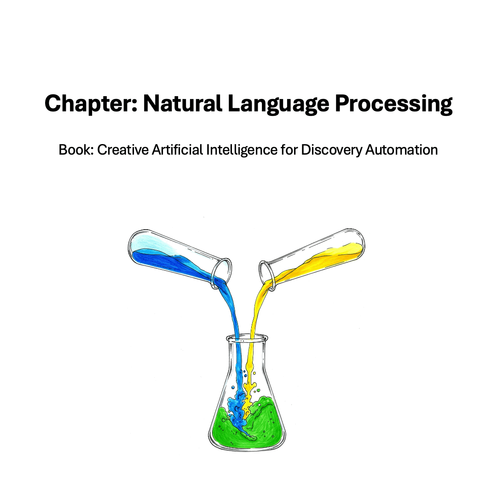

# Natural Language Processing

This repository corresponds to the "Natural Language Processing" chapter in the Book "[Creative Artificial Intelligence for Discovery Automation](https://www.cai4discovery.com)" written by Danial Khorasanian. 

## Contents

- Tokenization
- Token Representation
- Decoder-only Models
  - N-gram
  - Recurrent Neural Networks
  - Long Short-Term Memory
  - Decoder-only Transformers
- Encoder-Decoder Models
- Encoder-only Models
  - Semantic Similarity Tasks
  - Classification Tasks
- Large Language Models
  - Pre-Training
  - Supervised Fine-Tuning
  - RL for Fine-Tuning
  - Prompt
  - Inference
- Model Evaluation
  - Exact Match Metrics
  - Fuzzy Metrics

  

  
   
  NLP Chapter

